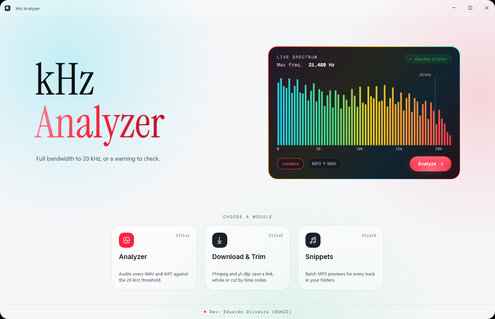
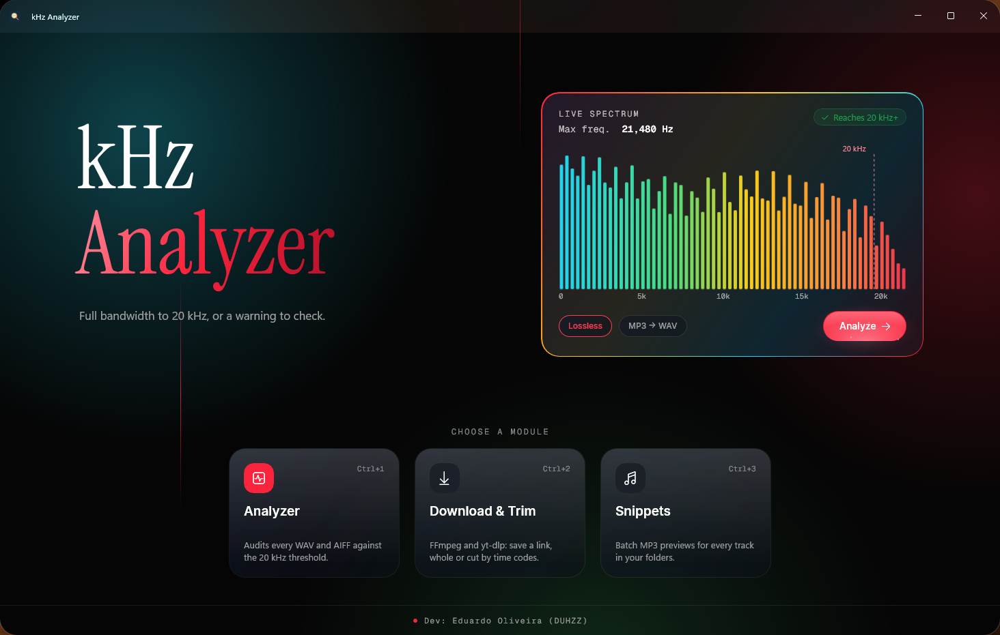
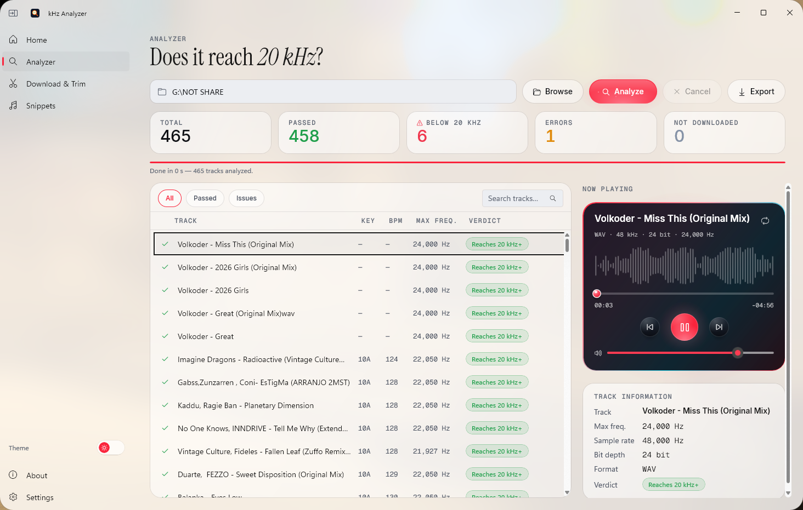
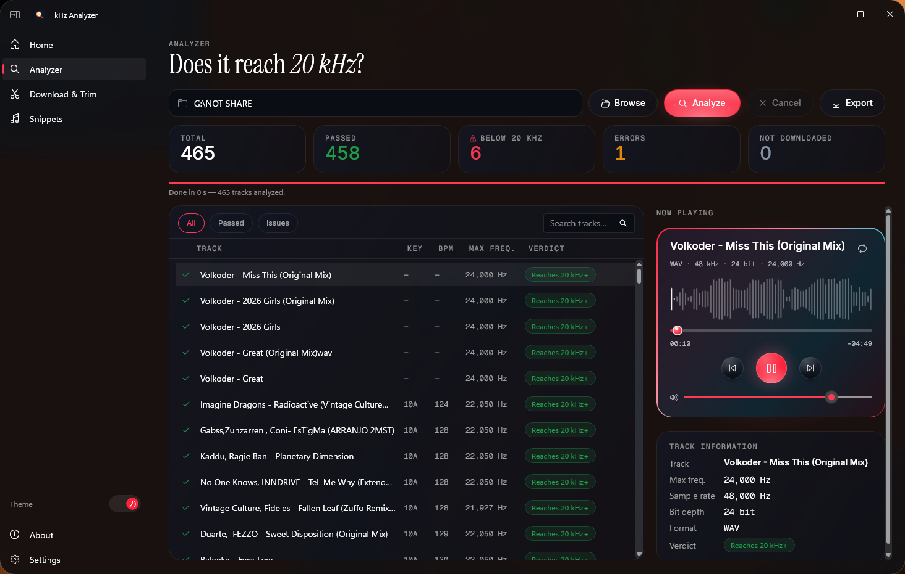
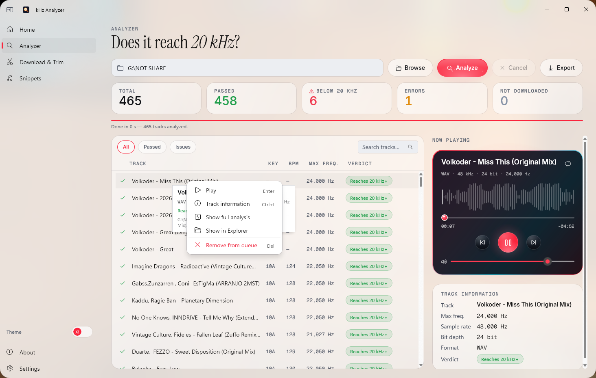
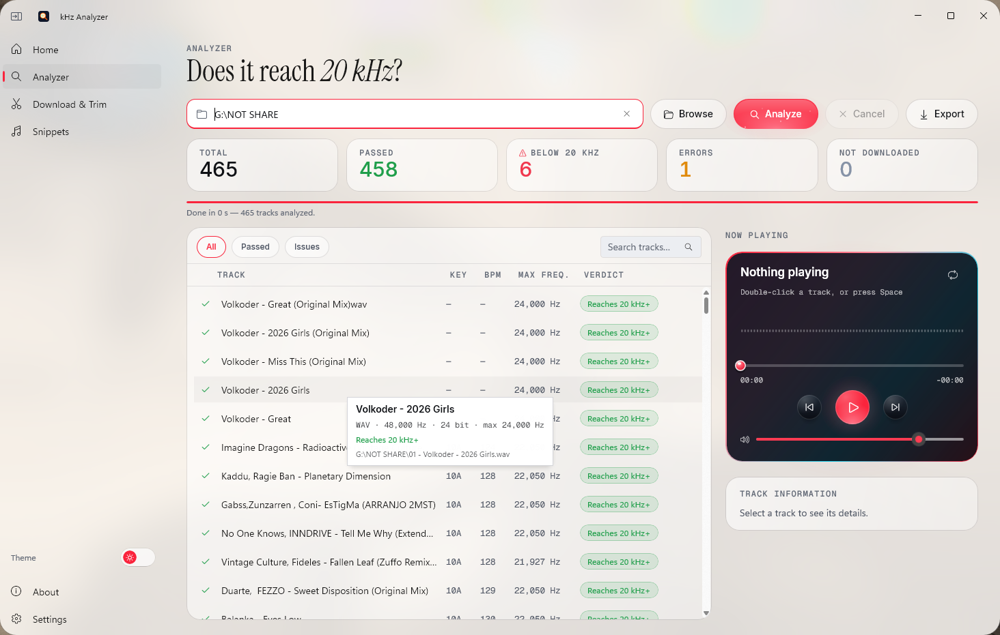
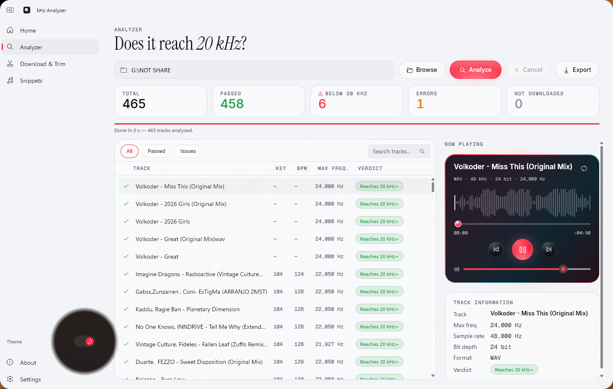
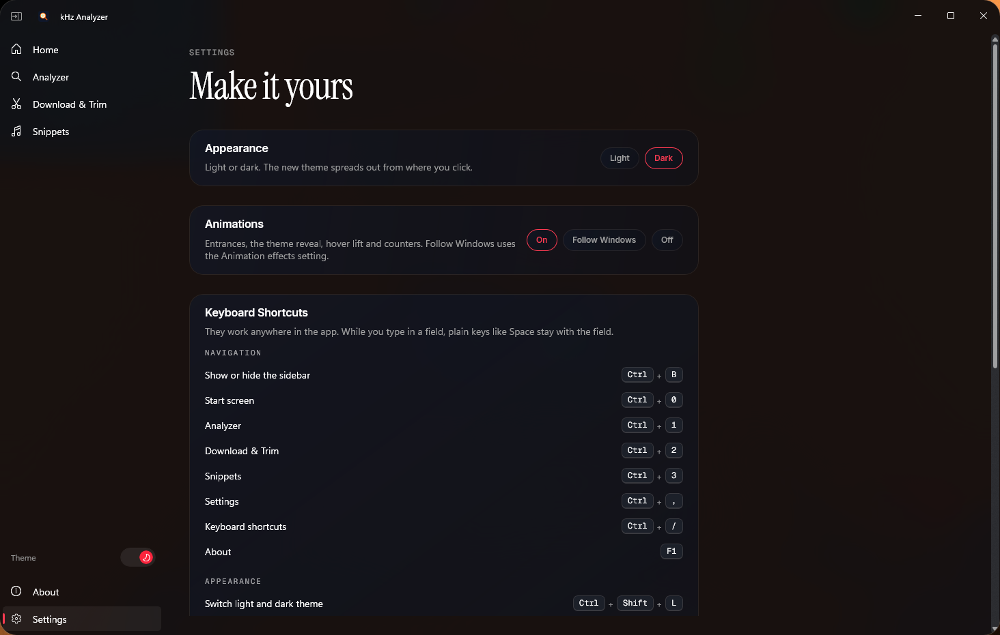

# kHz Analyzer

**Full bandwidth to 20 kHz, or a warning to check.**

O kHz Analyzer é um app gratuito para Windows 10 e 11, feito para DJs e produtores. Ele lê cada WAV e AIFF de uma pasta e diz se a faixa realmente chega a **20 kHz**. Tudo abaixo disso recebe **⚠** para você verificar: geralmente é um MP3 salvo como WAV. O app também baixa e corta áudio de links (Download & Trim) e gera prévias MP3 em lote (Snippets).



| | |
|---|---|
|  |  |
|  |  |
|  |  |
|  | |

## O que ele faz

- **Analyzer:** varre a pasta (com subpastas), mede até onde vai o conteúdo espectral real de cada faixa e dá o veredito:
  - **Reaches 20 kHz+**: passou.
  - **⚠ Below 20 kHz, check**: abaixo de 20 kHz, verifique.
  - **⚠ MP3 range (19 kHz), tolerated**: MP3 entre 19 e 20 kHz; tolerado, mas ainda com aviso.
  - **Unreadable file** ou **Not downloaded**: arquivo ilegível ou que está só na nuvem.

  Os relatórios em .docx e .csv mostram sempre o valor exato em Hz, para você decidir se usa o arquivo.
- **Now Playing:** toca WAV e AIFF direto da tabela (duplo clique, Enter ou Space), com forma de onda, timeline arrastável, volume e repetir.
- **Download & Trim:** cola um link do YouTube ou SoundCloud e salva em WAV, M4A, MP3 ou MP4, inteiro ou cortado por tempo (FFmpeg e yt-dlp).
- **Snippets:** cria uma prévia MP3 de cada faixa numa subpasta Snippets, sem tocar nos originais.

## Como a medição funciona

- O app não confia na taxa de amostragem do arquivo: um WAV de 44,1 kHz pode ter um corte em 16 kHz.
- A leitura é em streaming, do início ao fim da faixa, com FFT de 65.536 pontos, sobreposição de 50%, janela Hann e média de potência (Welch).
- O limiar vem do piso de ruído da própria profundidade de bits, mais 3 dB. A frequência máxima medida é a mais alta com conteúdo sustentado.
- A regra está em `kHzAnalyzer.Core/Verdict.cs`: limite de 20.000 Hz e tolerância de MP3 a partir de 19.000 Hz.
- As análises ficam em cache (SQLite) e reabrir uma pasta já analisada é quase instantâneo.

## Atalhos de teclado

| Atalho | Ação |
|---|---|
| Ctrl+B | Mostrar ou ocultar a barra lateral |
| Ctrl+0 / 1 / 2 / 3 | Início, Analyzer, Download & Trim, Snippets |
| Ctrl+, · Ctrl+/ · F1 | Settings, lista de atalhos, About |
| Ctrl+Shift+L | Alternar tema claro e escuro |
| Ctrl+O · F5 · Esc · Ctrl+E | Escolher pasta, analisar, cancelar, exportar |
| Ctrl+F · Ctrl+I · Del | Buscar, informações da faixa, remover da lista |
| Space · Ctrl+← / → · Shift+← / → | Play/pause, faixa anterior/próxima, voltar/avançar 10 s |

A lista completa fica em **Settings › Keyboard Shortcuts**.

## Instalação

Baixe na página de Releases:

- **`kHzAnalyzer-x.y.z-setup.exe`**: instalador que deixa escolher a pasta e o disco (C:, G:, etc.) e não pede permissão de administrador.
- **`kHzAnalyzer-x.y.z-portable.zip`**: versão portátil; é só extrair e abrir `kHzAnalyzer.exe`.

As configurações ficam em `%LOCALAPPDATA%\kHzAnalyzer` e o cache em `%APPDATA%\kHzAnalyzer`. Nada é enviado para a internet; só o Download & Trim acessa o site do link que você colar.

## Estrutura

- **`KhzAnalyzer/`**: interface WinUI 3 (.NET 10, sem pacote MSIX). Telas em `Pages/`, controles próprios em `Controls/` (espectro, player, timeline, fundo animado), player em `Services/`, tokens e estilos em `Styles/`.
- **`kHzAnalyzer.Core/`**: motor de análise em C# puro, com leitores WAV/AIFF, FFT, veredito, cache e relatórios .docx/.csv. Downloads e snippets ficam em `Media/`.
- **`tests/`**: testes de regressão e arquivos de referência (`fixtures/expected.md`).
- **`tools/`**: verificação do motor (`kHzAnalyzer.ConsoleTest --verificar`), build do instalador (`build-release.ps1`) e scripts de teste da interface.
- **`docs/`**: decisões da spec (`spec-v2.1-decisions.md`) e prints (`screenshots/`).

## Desenvolvimento

```powershell
dotnet build KhzAnalyzer\KhzAnalyzer.csproj -c Debug -p:Platform=x64
dotnet test tests\KhzAnalyzer.RegressionTests
powershell -ExecutionPolicy Bypass -File tools\build-release.ps1   # instalador e zip em dist\
```

O histórico de versões, com bugs e correções, está no [CHANGELOG](CHANGELOG.md).

---

Dev: Eduardo Oliveira (DUHZZ)
